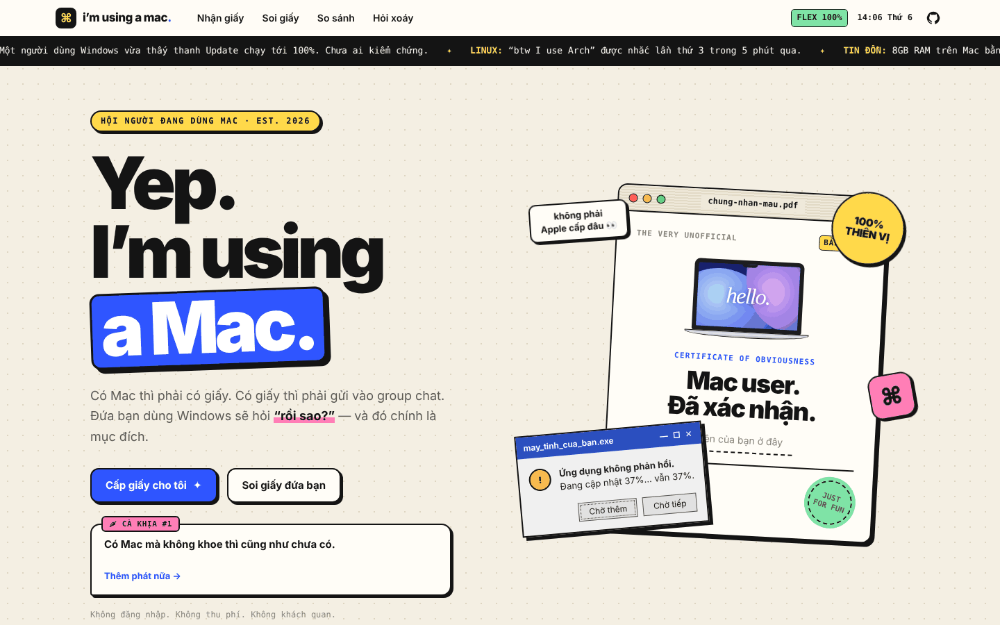

# I’m using a Mac.

**Hội người đang dùng Mac. Có giấy hẳn hoi. Thiên vị công khai.**



`iamusingmac` là một website để flex chiếc Mac với bạn bè: mở trang, nhận giấy chứng nhận mang tên mình, rồi gửi link cho đứa bạn dùng Windows. Nó vẫn soi được giấy của bạn — hội không kỳ thị lúc soi. Chỉ có hồ sơ gia nhập của nó là… bị từ chối một cách rất lịch sự.

Mã nguồn: [philngt/iamusingmac](https://github.com/philngt/iamusingmac).

## Cách flex

1. Mở trang trên Mac và để trình duyệt tự khai báo nền tảng.
2. Điền tên bạn muốn in lên giấy. Càng oách càng tốt.
3. Nhận chứng nhận có tên, ngày gia nhập và mã riêng.
4. Sao chép link gửi vào group chat. Người nhận mở link hoặc dán mã đầy đủ/file JSON vào trang để soi.
5. Chờ ai đó hỏi “rồi sao?”. Đó chính là mục đích.

| Bạn đang dùng gì? | Hội phản hồi thế nào? |
| --- | --- |
| Mac | “Chuẩn Mac. Hội gật đầu.” Mời nhận giấy |
| Windows | “Ồ… Windows.” Hồ sơ bị từ chối, kèm watermark *Kích hoạt macOS* ở góc màn hình |
| Linux | “Kính nể. Nhưng không.” `sudo` cũng không cứu được |
| ChromeOS | Bị nhầm thành một tab Chrome |
| iPhone, iPad, Android | Soi giấy thoải mái; nhận giấy thì cần mở trên Mac |

Trên trang còn có bản tin chạy chữ, nút “cà khịa thêm phát nữa” và một bảng so sánh khách quan tuyệt đối (độc lập với sự thật). Hội cũng tự cà khịa Mac — hub USB-C, chơi game, giá một quả thận — cho công bằng.

Chứng nhận đã tạo nằm trong lịch sử của trình duyệt để mở lại. Khi gửi sang máy khác, dùng **link, mã đầy đủ `IUM1.…` hoặc file JSON**; ID ngắn `MAC-…` chỉ tra được trong lịch sử đã lưu của chính trình duyệt đó.

Đây là trang giải trí độc lập, không liên quan Apple. “Chứng nhận” dựa trên thông tin trình duyệt và tên tự nhập, nên hãy dùng để trêu bạn bè, không dùng làm bằng chứng sở hữu máy.

## Chạy trên máy cá nhân

HTML, CSS và JavaScript thuần trong `dist/`. Không cần framework, cài package, backend, cơ sở dữ liệu hay API key.

Cần Python 3 để mở server tĩnh. Node.js 24 trở lên chỉ cần cho kiểm tra tự động.

Lấy mã nguồn và mở server tĩnh:

```bash
git clone https://github.com/philngt/iamusingmac.git
cd iamusingmac
python3 -m http.server 8000 --directory dist
```

Mở [http://localhost:8000](http://localhost:8000). Dùng `localhost` khi thử trên máy cá nhân và HTTPS khi phát hành. Không mở trực tiếp `dist/index.html` bằng `file://`: ES modules và Web Crypto cần môi trường trình duyệt phù hợp.

Chạy kiểm tra mà không cần `npm install`:

```bash
npm test
npm run check
```

`npm test` chạy các trường hợp nhận diện thiết bị và tạo/kiểm tra chứng nhận. `npm run check` kiểm tra cú pháp JavaScript, file được tham chiếu và đường dẫn tương đối để tránh lỗi khi deploy dưới `/iamusingmac/`. Các kiểm tra này không thay thế thử nghiệm giao diện trên Safari, Chrome và Firefox thực tế.

## Đưa lên GitHub Pages

1. Đưa toàn bộ nội dung dự án vào nhánh `main` của [philngt/iamusingmac](https://github.com/philngt/iamusingmac). Nếu tự host bản fork, dùng repository của bạn; với GitHub Free, dùng repository public để host qua Pages.
2. Trong [Settings → Pages](https://github.com/philngt/iamusingmac/settings/pages), mở **Build and deployment**; chọn **GitHub Actions** ở mục **Source**. Với bản fork, mở phần Settings của repository tương ứng.
3. Push commit lên `main`. Nếu commit đã được push trước khi bật Pages, mở **Actions → Verify and deploy GitHub Pages → Run workflow**, chọn `main`.
4. Chờ job kiểm tra và job deploy hoàn tất. Lấy URL thật từ **Settings → Pages** hoặc environment **github-pages** của workflow.

URL mặc định dự kiến cho repository này là:

```text
https://philngt.github.io/iamusingmac/
```

Đây là ví dụ về URL dự kiến, không phải xác nhận website đã được xuất bản ở địa chỉ đó.

Workflow `.github/workflows/pages.yml` chạy test và kiểm tra static trước khi upload duy nhất thư mục `dist/`. Job kiểm tra chỉ có quyền đọc source; job deploy có quyền `pages: write` và `id-token: write`. Các lần deploy cùng nhóm được xếp hàng, không hủy một bản đang publish. Chạy thủ công từ nhánh khác `main` chỉ kiểm tra, không deploy.

Không chọn **Deploy from a branch / root** với cấu trúc này, vì trang chính nằm trong `dist/`; workflow đã lo việc upload đúng thư mục. Nếu đổi tên nhánh mặc định, sửa cả điều kiện `push.branches` và `github.ref` trong workflow.

Nếu workflow báo không tìm thấy Pages hoặc `Not Found` tại bước cấu hình, bật **Settings → Pages → Source: GitHub Actions** rồi chạy lại workflow. Không cần thêm personal access token hoặc secret riêng.

## Dành cho người sửa code

### Nhận diện và mã chứng nhận

`dist/core.mjs` đọc thông tin nền tảng do trình duyệt cung cấp, ưu tiên Client Hints khi có và dùng User-Agent/platform làm dự phòng. Luồng nhận diện loại trừ iPhone, Android và iPad ở chế độ desktop khi có đủ tín hiệu phân biệt; không suy đoán phiên bản macOS hay loại chip chính xác.

Khi cấp chứng nhận, trình duyệt tạo cặp khóa ECDSA P-256 tạm thời, ký nội dung và đưa khóa công khai vào mã `IUM1.…`. Khóa riêng không được lưu. ID `MAC-…` được tính từ nội dung. Bên nhận kiểm tra chữ ký trực tiếp trong trình duyệt, không gọi backend.

Chữ ký khớp chỉ cho biết nội dung nhất quán với khóa công khai đi kèm. Mã là **tự cấp**: bất kỳ ai cũng có thể sinh khóa và ký lại; tín hiệu thiết bị có thể giả lập, tên tự nhập và thời gian lấy từ đồng hồ máy. Không có nguồn cấp trung tâm hay thu hồi chứng nhận. Kết quả cũng không nói gì về thiết bị mà người nhận đang dùng để mở link.

Link dùng fragment `#verify=IUM1.…`, nên chạy dưới `/iamusingmac/` trên GitHub Pages mà không cần route phía server. Không có cơ sở dữ liệu chung để tra ID ngắn; việc chia sẻ cần mang theo mã đầy đủ.

### Dữ liệu và riêng tư

- Mã ứng dụng không gửi chứng nhận đến backend và không có analytics.
- Lịch sử nằm trong bộ nhớ cục bộ của trình duyệt. Xóa lịch sử trong trang hoặc dữ liệu website của trình duyệt để xóa bản lưu trên máy đó.
- Xóa lịch sử không thu hồi file, mã hay link đã chia sẻ; các bản sao vẫn có thể được kiểm tra độc lập.
- Mã chứa tên đã nhập và thông tin chứng nhận. Hãy dùng tên hiển thị bạn muốn chia sẻ.
- Trang không đọc serial máy, Apple ID hoặc danh tính phần cứng. Nó không dùng User-Agent để suy đoán phiên bản macOS hoặc loại chip chính xác.
- Dịch vụ host vẫn có thể ghi log các lượt tải trang theo chính sách của họ. Fragment chứng nhận không nằm trong HTTP request tải trang, nhưng người nhận link và script chạy trên trang đọc được nó.

### Các file chính

| File/thư mục | Vai trò |
| --- | --- |
| `dist/index.html` | Giao diện và cấu trúc nội dung |
| `dist/styles.css` | Giao diện retro-Mac responsive (viền đậm, bóng đổ cứng, tôn trọng `prefers-reduced-motion`) |
| `dist/app.mjs` | Tương tác, lời thoại theo hệ điều hành, ảnh PNG, chia sẻ, lịch sử cục bộ |
| `dist/core.mjs` | Nhận diện thiết bị, tạo và kiểm tra chứng nhận |
| `tests/` | Kiểm tra tự động với Node.js |
| `docs/preview.png` | Ảnh xem trước cho README (không được deploy) |
| `scripts/check-static.mjs` | Kiểm tra asset, import và đường dẫn cho Pages |
| `.github/workflows/pages.yml` | Kiểm tra và triển khai tự động |

### Tài liệu nền tảng

- [GitHub Pages: cấu hình nguồn xuất bản](https://docs.github.com/en/pages/getting-started-with-github-pages/configuring-a-publishing-source-for-your-github-pages-site)
- [GitHub Pages: workflow tùy chỉnh](https://docs.github.com/en/pages/getting-started-with-github-pages/using-custom-workflows-with-github-pages)
- [MDN: giới hạn của User-Agent](https://developer.mozilla.org/en-US/docs/Web/API/Navigator/userAgent)
- [MDN: Web Crypto API](https://developer.mozilla.org/en-US/docs/Web/API/Web_Crypto_API)
- [MDN: URL fragment](https://developer.mozilla.org/en-US/docs/Web/URI/Reference/Fragment)
